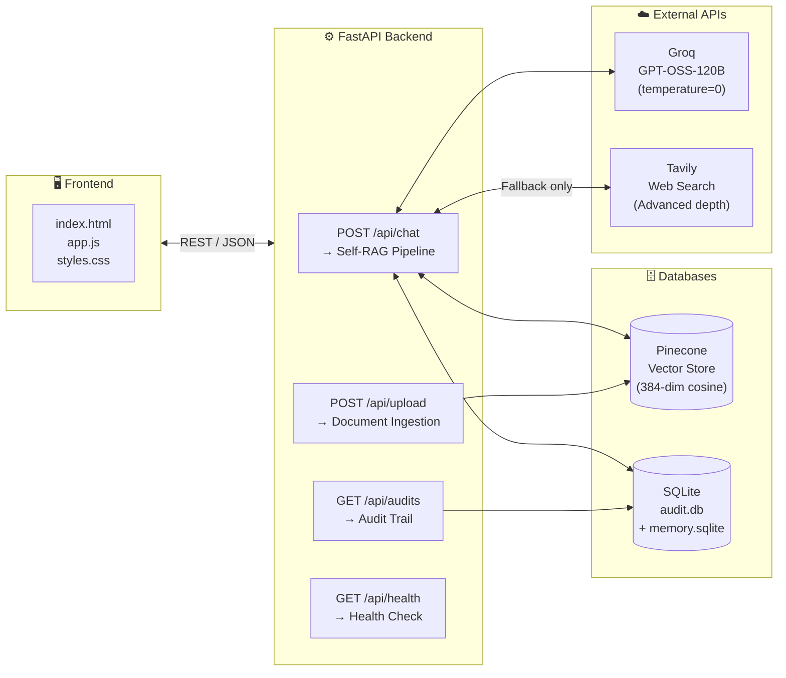
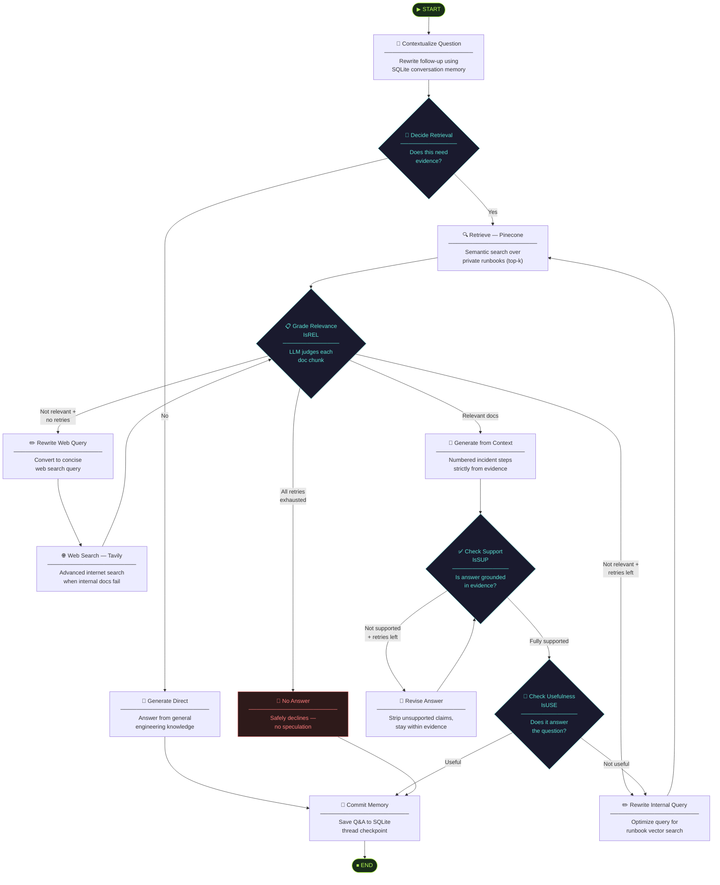
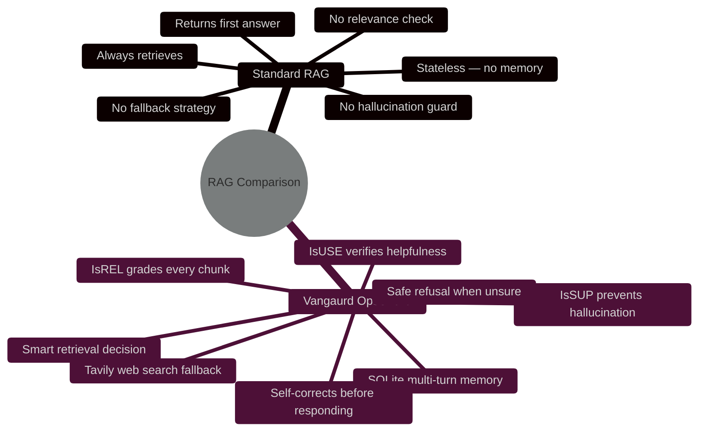

<div align="center">

# 🛡️ Vangaurd OpsSheild

**Self-RAG Incident Response Copilot for Cloud Operations**

*Ground every troubleshooting decision in private runbook evidence. Never hallucinate a production fix again.*

<br/>


<br/>

### 🌐 [Live Demo →](#) <!-- 🔗 Add your deployment link here -->

*[Website / Demo video link — add yours here]*

<br/>

[Features](#-features) · [How It Works](#-how-it-works) · [Architecture](#-system-architecture) · [Self-RAG Pipeline](#-self-rag-pipeline) · [Tech Stack](#-tech-stack) · [Getting Started](#-getting-started) · [API Docs](#-api-reference) · [Database](#-database-schema)

</div>

---

## 🎯 The Problem It Solves

During a production incident, on-call engineers are under enormous pressure. They have to:

- Hunt through **scattered runbooks, SOPs, and postmortems** under time pressure
- Trust LLM responses that could **hallucinate dangerous production steps**
- Lose context when asking **follow-up questions** during a triage session
- Know *when* internal docs are insufficient and web search is needed

Standard RAG chatbots are not reliable enough for incident response — they don't verify their own outputs, they don't remember your conversation, and they have no fallback strategy.

---

## 💡 What Vangaurd OpsSheild Does

**Vangaurd OpsSheild** is an AI-powered incident response copilot that uses a **Self-Reflective RAG (Self-RAG)** pipeline to ensure every answer is verifiably grounded in evidence before it reaches the engineer.

> **It doesn't just answer. It thinks, retrieves, verifies, self-corrects, and only then responds.**

### The 7-Step Guarantee

| Step | Action | What It Prevents |
|:----:|--------|-----------------|
| 1️⃣ | **Contextualize** — rewrites follow-ups using conversation memory | Loss of incident context |
| 2️⃣ | **Decide** — LLM decides if retrieval is even needed | Unnecessary retrieval on simple queries |
| 3️⃣ | **Retrieve** — semantic search over private runbooks (Pinecone) | Hallucinated runbook steps |
| 4️⃣ | **Grade (IsREL)** — each document is judged for relevance | Irrelevant context polluting the answer |
| 5️⃣ | **Verify (IsSUP)** — answer is checked for grounding in evidence | Hallucination in generated steps |
| 6️⃣ | **Evaluate (IsUSE)** — checks if the answer actually helps | Technically correct but useless responses |
| 7️⃣ | **Web Fallback** — Tavily search activates *only if* internal docs fail | Gaps in private knowledge base |

---

## ✨ Features

- 🧠 **Self-RAG Engine** — 13-node LangGraph state machine with reflection loops
- 📚 **Private Knowledge Base** — upload PDF, DOCX, TXT, or MD runbooks at runtime
- 💬 **Multi-Turn Memory** — per-session SQLite checkpoints maintain full incident context
- 🔁 **Adaptive Query Rewriting** — automatically retries with a better query if retrieval fails
- 🌐 **Smart Web Fallback** — Tavily internet search kicks in only when private docs are exhausted
- 🔍 **Full Audit Trail** — every query, answer, trace, and source citation stored in SQLite
- 🧾 **Source Attribution** — every response cites its evidence (runbook chunk + page number or URL)
- 🖥️ **Incident Console UI** — dark-themed terminal-style interface with live status indicators
- 🐳 **Docker Ready** — containerized, port-configurable production deployment
- 📡 **LangSmith Tracing** — full observability over LLM calls and pipeline steps

---

## 🏗 System Architecture



---

## 🔄 Self-RAG Pipeline

The pipeline is built as a **LangGraph StateGraph** with 13 nodes and conditional routing edges. Every node is a distinct, testable function. The system self-corrects using three reflection tokens before returning an answer.



### Self-RAG Reflection Tokens Explained

| Token | Stands For | What It Does |
|-------|-----------|-------------|
| `IsREL` | **Is Relevant** | LLM judges each retrieved chunk — irrelevant ones are dropped before generation |
| `IsSUP` | **Is Supported** | Verifies the generated answer is backed by evidence — the hallucination guard |
| `IsUSE` | **Is Useful** | Checks the answer actually addresses the engineer's specific incident |

---

## 📁 Project Structure

```
vangaurd-opssheild/
│
├── 📄 app.py                   # FastAPI app — routes, startup, middleware
├── 📄 data_ingestion.py        # CLI: batch-ingest documents into Pinecone
├── 📄 template.py              # Project scaffolding utility
├── 📄 requirements.txt         # Python dependencies
├── 🐳 Dockerfile               # Production container (Python 3.11-slim)
├── 🔒 .env                     # API keys & config (gitignored)
│
├── 📂 src/                     # Core application modules
│   ├── ⭐ self_rag.py          # Self-RAG pipeline — 13-node LangGraph state machine
│   ├── 📄 config.py            # Pydantic Settings — centralized env var management
│   ├── 📄 vectorstore.py       # Pinecone client, index lifecycle, retriever factory
│   ├── 📄 ingestion.py         # Document loading, chunking, SHA-256 dedup, upsert
│   ├── 📄 models.py            # Pydantic request/response schemas
│   └── 📄 db.py                # SQLite audit trail — init, write, query
│
├── 📂 documents/               # Sample runbooks (pre-loaded into Pinecone)
│   ├── checkout-api-runbook.md
│   ├── deployment-rollback-sop.md
│   └── payments-high-cpu-runbook.md
│
├── 📂 templates/
│   └── index.html              # Incident Response Console — Jinja2 template
│
├── 📂 static/
│   ├── styles.css              # Dark terminal UI (JetBrains Mono + DM Sans)
│   └── app.js                  # Chat client, file uploader, session manager
│
├── 📂 data/                    # Runtime databases (gitignored)
│   ├── audit.db                # All query audit records
│   └── langgraph_memory.sqlite # LangGraph conversation checkpoints
│
├── 📂 uploads/                 # User-uploaded runbooks at runtime
│
└── 📂 Self-Rag-Code/           # Research & experimentation
    └── self_rag.ipynb          # Jupyter prototype — original Self-RAG research
```

---

## 🛠 Tech Stack

| Layer | Technology | Version | Why |
|-------|-----------|---------|-----|
| **Web Framework** | FastAPI + Uvicorn | ≥0.115 | Async endpoints, `run_in_threadpool` for non-blocking LangGraph |
| **AI Orchestration** | LangGraph | ≥0.2 | Stateful graph-based pipeline with conditional routing |
| **LLM** | Groq — GPT-OSS-120B | via API | `temperature=0` for deterministic, consistent triage answers |
| **Vector Database** | Pinecone Serverless | ≥5.0 | Cosine similarity search; AWS us-east-1; namespace-isolated |
| **Embeddings** | HuggingFace `all-MiniLM-L6-v2` | local | 384-dim local inference — zero API cost, no data exposure |
| **Web Search** | Tavily API | ≥0.5 | Advanced search depth; only activated as a fallback |
| **Conversation Memory** | LangGraph SQLite Checkpointer | — | Per-thread persistent state via `SqliteSaver` |
| **Audit Database** | SQLite (`sqlite3`) | stdlib | Zero-dependency audit logging with full JSON trace |
| **Document Parsing** | PyPDF + python-docx + LangChain | — | Supports PDF, DOCX, TXT, MD |
| **Text Chunking** | `RecursiveCharacterTextSplitter` | — | 800-char chunks, 160-char overlap |
| **Frontend** | Vanilla JS + CSS3 + Jinja2 | — | Dark terminal UI, no framework dependencies |
| **Observability** | LangSmith | — | Full LLM call tracing, latency, token usage |
| **Containerization** | Docker (Python 3.11-slim) | — | Configurable `PORT` env var |

---

## 🗄 Database Schema

### `audit.db` — Interaction Audit Trail

Every single Self-RAG interaction is logged here for full observability.

```sql
CREATE TABLE rag_audit (
    id              INTEGER PRIMARY KEY AUTOINCREMENT,
    created_at      TEXT    NOT NULL,   -- ISO 8601 UTC timestamp
    question        TEXT    NOT NULL,   -- Original user query
    answer          TEXT    NOT NULL,   -- Final generated response
    route           TEXT,               -- "Private Runbooks" | "Internet Search" | "General Knowledge" | "No Reliable Evidence"
    used_web        INTEGER DEFAULT 0,  -- 1 if Tavily search was activated
    support_status  TEXT,               -- IsSUP: "fully_supported" | "partially_supported" | "no_support"
    usefulness      TEXT,               -- IsUSE: "useful" | "not_useful"
    trace_json      TEXT,               -- JSON array of every pipeline step taken
    sources_json    TEXT                -- JSON array of cited sources (title, page, URL)
);
```

### `langgraph_memory.sqlite` — Conversation Memory

Managed automatically by LangGraph's `SqliteSaver`. Stores full pipeline state per `thread_id`, enabling multi-turn incident triage where follow-up questions have full context of earlier exchanges.

---

## 📡 API Reference

### `POST /api/chat`
Run the full Self-RAG pipeline on an incident query.

**Request**
```json
{
  "question": "Our checkout API is returning 502 errors after deployment",
  "thread_id": "incident-abc123"
}
```

**Response**
```json
{
  "answer": "1. Compare the incident start time with the latest deployment timestamp.\n2. Check Kubernetes deployment and pod status for checkout-api...",
  "route": "Private Runbooks",
  "used_web_search": false,
  "support_status": "fully_supported",
  "usefulness": "useful",
  "sources": [
    {
      "type": "internal",
      "title": "checkout-api-runbook.md",
      "source": "documents/checkout-api-runbook.md",
      "page": 1
    }
  ],
  "trace": [
    "Memory: new incident session",
    "Retrieval decision: true",
    "Internal retrieval: 5 chunks",
    "Relevance grade (internal): 3/5 relevant",
    "Generated answer from internal evidence",
    "Support check: fully_supported",
    "Usefulness check: useful",
    "SQLite memory checkpoint updated"
  ],
  "thread_id": "incident-abc123",
  "memory_turns": 1
}
```

### `POST /api/upload`
Upload a runbook to expand the knowledge base at runtime.

```json
// Response
{
  "filename": "k8s-troubleshooting.pdf",
  "chunks_indexed": 42,
  "namespace": "incident-runbooks"
}
```

### `GET /api/audits?limit=20`
Retrieve the most recent audit log entries.

### `GET /api/health`
Health check for container orchestration and load balancers.

---

## 🚀 Getting Started

### Prerequisites

- Python 3.11+
- A [Pinecone](https://www.pinecone.io/) account (free tier works)
- A [Groq](https://groq.com/) API key (free)
- A [Tavily](https://tavily.com/) API key (optional — for web fallback)

### Step 1 — Clone & Install

```bash
git clone https://github.com/<your-username>/vangaurd-opssheild.git
cd vangaurd-opssheild

python -m venv .venv
source .venv/bin/activate    # Windows: .venv\Scripts\activate

pip install -r requirements.txt
```

### Step 2 — Configure `.env`

```env
# ── LLM ─────────────────────────────────────
GROQ_API_KEY=your_groq_api_key
GROQ_MODEL=openai/gpt-oss-120b

# ── Embeddings (runs locally, no key needed) ─
EMBEDDING_MODEL=all-MiniLM-L6-v2
EMBEDDING_DIMENSION=384

# ── Vector Store ─────────────────────────────
PINECONE_API_KEY=your_pinecone_api_key
PINECONE_INDEX_NAME=vangaurd-opssheild-self-rag
PINECONE_NAMESPACE=incident-runbooks
PINECONE_CLOUD=aws
PINECONE_REGION=us-east-1

# ── Web Search Fallback (optional) ───────────
TAVILY_API_KEY=your_tavily_api_key

# ── Self-RAG Tuning ───────────────────────────
TOP_K=5
MAX_SUPPORT_RETRIES=2
MAX_RETRIEVAL_REWRITES=2
MAX_WEB_REWRITES=2
DATABASE_PATH=data/audit.db

# ── Observability (optional) ─────────────────
LANGSMITH_API_KEY=your_langsmith_key
LANGSMITH_TRACING=true
LANGSMITH_PROJECT=Vangaurd-OpsSheild
```

### Step 3 — Ingest Your Runbooks

```bash
# Drop your runbooks into /documents, then:
python data_ingestion.py
```

The script will chunk your documents (800 chars, 160 overlap), embed them locally using MiniLM, and upsert them into your Pinecone index. Chunks are deduplicated via SHA-256 IDs — re-running is safe.

### Step 4 — Run the App

```bash
# Development
uvicorn app:app --host 0.0.0.0 --port 8080 --reload

# Or directly
python app.py
```

Open **http://localhost:8080**

### Step 5 — Docker

```bash
docker build -t vangaurd-opssheild .
docker run -p 8080:8080 --env-file .env vangaurd-opssheild
```

---

## 🧪 Try These Queries

Once running, paste these into the console to see the full Self-RAG pipeline in action:

| Query | Expected Route | What Activates |
|-------|---------------|----------------|
| *"Our checkout API is returning 502 errors after deployment"* | Private Runbooks | Retrieval → IsREL → IsSUP → IsUSE |
| *"CPU on the payments service is above 90%"* | Private Runbooks | Retrieval → IsREL → IsSUP → IsUSE |
| *"What is the rollback procedure?"* → *"What do I check after?"* | Private Runbooks + Memory | Multi-turn context from SQLite |
| *"Why does CrashLoopBackOff happen in Kubernetes?"* | Internet Search | Tavily fallback (not in runbooks) |
| *"Hello, how are you?"* | General Knowledge | No retrieval — direct answer |

---

## 📊 Self-RAG vs. Standard RAG



---

## ⚡ Key Engineering Decisions

| Decision | Rationale |
|----------|----------|
| **Structured JSON-mode evaluators** | All reflection nodes (IsREL, IsSUP, IsUSE) use Pydantic schemas with `json_mode` — zero fragile string parsing |
| **SHA-256 idempotent chunk IDs** | Re-uploading a runbook doesn't create duplicate vectors; IDs are `hash(filename\|position\|content)` |
| **Local HuggingFace embeddings** | Zero API cost, no data sent externally, faster than remote embedding calls |
| **`run_in_threadpool` offloading** | Synchronous LangGraph runs in a thread pool so FastAPI's async event loop stays unblocked |
| **`temperature=0` on all LLM calls** | Deterministic, reproducible triage answers — critical in production incident response |
| **Safe refusal mode** | When no evidence exists, the system explicitly refuses rather than speculate on production commands |
| **Namespace isolation in Pinecone** | Multiple knowledge domains can coexist in one index without cross-contamination |
| **LangSmith tracing enabled** | Full production observability — latency, token usage, and step-by-step traces |

---

## 🌐 Live Demo

> **🔗 [Add your deployment link here](https://your-link.com)**
>
> *(Replace this placeholder with your live URL, Hugging Face Space, or a Loom/YouTube demo video link.)*

---

## 🤝 Contributing

Contributions are welcome! Here's how to get started:

1. Fork the repository
2. Create your feature branch — `git checkout -b feature/your-feature`
3. Commit your changes — `git commit -m 'feat: add your feature'`
4. Push to the branch — `git push origin feature/your-feature`
5. Open a Pull Request

---

## 📄 License

This project is open source, available under the [MIT License](LICENSE).

---

<div align="center">

**Built with** · LangGraph · Pinecone · Groq · Tavily · FastAPI · HuggingFace · SQLite · Docker

<br/>

*If this project helped you, consider giving it a ⭐ on GitHub!*

</div>